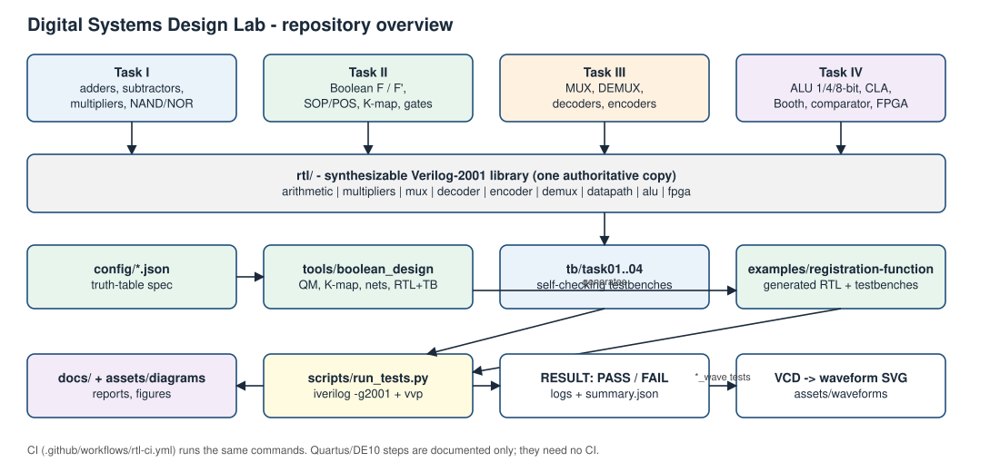
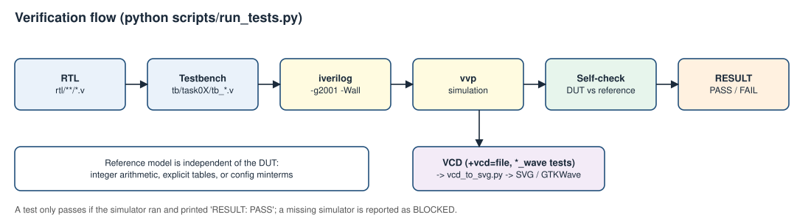
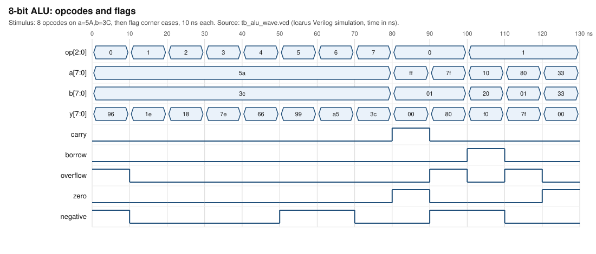

# Digital Systems Design Lab — Verilog RTL, Logic Design and FPGA Verification

Verilog-2001 RTL, self-checking testbenches, a Boolean-function design toolchain and generated diagrams/waveforms for the four BECE102P *Digital Systems Design Lab* tasks: adders and multipliers, Boolean minimization and NAND/NOR realizations, MUX/decoder/encoder hierarchies, and an ALU with carry-lookahead and Booth multiplication. Everything shown was produced from the RTL or from real Icarus Verilog simulations in this repository.



*Overview of tasks, RTL library, generators and the verification workflow (`assets/diagrams/repo_overview.svg`).*



*RTL → testbench → simulator → self-check → waveform (`assets/diagrams/verification_flow.svg`).*

## Tasks at a glance
| Task | Topic | Document | Key modules |
|---|---|---|---|
| I | Adders, subtractors, multipliers, NAND/NOR gate counts | [task01](docs/task01-combinational-design.md) | `full_adder`, `ripple_adder4`, `mult4x4`, `*_nand`, `*_nor` |
| II | F/F′ from a truth table, SOP/POS, K-map, AOI/OAI/NAND/NOR | [task02](docs/task02-boolean-minimization.md) | generator in `tools/boolean_design` |
| III | MUX, demux, decoders, encoders, function realization | [task03](docs/task03-mux-decoder-encoder.md) | `mux16`, `decoder4to16`, `priority_encoder8to3` |
| IV | ALU (1/4/8-bit), CLA, comparator, Booth, FPGA flow | [task04](docs/task04-alu-fpga.md) | `alu`, `cla_adder4`, `booth_mult`, `comparator4` |

Also: [theory/viva notes](docs/theory/README.md), [requirements traceability](docs/requirements-traceability.md), [references](docs/references.md), [simulation guide](docs/simulation/simulation-workflows.md), [FPGA guide](docs/fpga/quartus-de10-workflow.md).

## Features
* 108 synthesizable Verilog-2001 modules (behavioral `_bh`, dataflow `_df`, structural), no SystemVerilog.
* Exhaustive checks for the small blocks, including all 524 288 `(a, b, op)` ALU vectors at 8 bits and all 65 536 signed operand pairs for the 8-bit Booth multiplier.
* Config-driven Boolean toolchain (Quine–McCluskey, K-map SVG, 2-input-gate networks with gate counts, generated RTL + testbench).
* Diagrams drawn from the RTL by script; waveforms rendered from real VCD files.
* Portable Python test runner (stdlib only), Makefile, GitHub Actions workflow.

## Module inventory
| Folder | Modules |
|---|---|
| `rtl/arithmetic` | half/full adder & subtractor (3 styles), `*_nand`/`*_nor`, MUX- and decoder-based FA/FS, `ripple_adder4` (+`_gates`,`_df`,`_bh`,`_nand`,`_nor`), `ripple_adder_n`, `cla_adder4`, `cla_adder16` |
| `rtl/multipliers` | `mult2x2/3x3/4x4` (+`_df`,`_bh`), `mult_array_n`, `booth_mult` |
| `rtl/mux` | `mux2` (+`_bh`,`_sop`,`_pos`,`_nand`,`_nor`), `mux4/8/16` (+`_df`,`_bh`) |
| `rtl/decoder` | `decoder1to2…4to16` (+`_df`,`_bh`,`_n`), `decoder2to4_sop/_pos/_nand/_nor` |
| `rtl/encoder`, `rtl/demux` | simple and priority encoders 4:2 / 8:3; `demux1to2`, `demux1to4` |
| `rtl/datapath` | incrementer, decrementer, adder/subtractor, `comparator1`, `comparator4` |
| `rtl/alu` | `alu`, `alu_1bit/4bit/8bit`, structural `alu_st`, `alu_opcodes.vh` |
| `rtl/fpga` | board-agnostic tops: `fpga_half_adder_top`, `fpga_alu4_top` |

## Tool requirements
Required: Python 3.8+, Icarus Verilog (`iverilog`, `vvp`; tested with 12.0). Optional: GTKWave, Yosys (latch lint). Course tools — ModelSim and Quartus Prime Lite 20.1 — are *not* needed for any test or CI job. See `requirements-dev.txt`.

## Quick start (fresh clone)
```
git clone https://github.com/yash-mehta13/Digital-Systems-Design-Lab.git
cd Digital-Systems-Design-Lab
python scripts/run_tests.py --check-tools
python scripts/run_tests.py
```
(Use the actual repository URL/folder name of your clone.) Same commands in Windows PowerShell. More: `python scripts/run_tests.py --task 3`, `--test tb_alu`, `--list`, `--lint`; `make all-checks` on Linux/macOS. Without Icarus Verilog the runner reports `BLOCKED`, never a pass.

Regenerate artifacts:
```
python tools/boolean_design/boolean_design.py --config config/boolean_function.example.json
python scripts/render_diagrams.py
python scripts/make_waveforms.py
python tools/verification/gate_count.py --write
```

## Test coverage (from the recorded run)
20/20 testbenches pass with Icarus Verilog 12.0 (`-g2001 -Wall`): see [test_results.md](docs/simulation/test_results.md) for per-testbench comparison counts. Highlights: adders/subtractors/multipliers exhaustive; MUX/decoder/encoder all selects/addresses/patterns; ALU exhaustive at 1/4/8 bits; Booth exhaustive at N=4 and N=8 plus protocol tests; CLA-16 uses corners + 200 000 random vectors (not exhaustive). Yosys found no inferred latches in any of the 108 modules (`scripts/synth_check.py`). Deliberate bug injection (see Task IV doc) confirmed the testbenches fail when the RTL is wrong. These results come from simulation only; CI workflow status on GitHub has not been observed.

## Waveforms
Each `assets/waveforms/*.svg` is rendered from the neighbouring `*.vcd` produced by a self-checking `*_wave` testbench; open the VCD in GTKWave for interactive viewing.



*8-bit ALU opcodes and flags, simulation output (`assets/waveforms/alu_wave.svg`).*

## FPGA status
**Documented, not executed.** Quartus Prime Lite 20.1 and a DE10 board were unavailable. Top levels and templates exist; the DE10 variant, device and pin numbers are *not* supplied (the sheet does not give them). See the [FPGA guide](docs/fpga/quartus-de10-workflow.md).

## Task II registration-number input
The sheets define no rule mapping a registration number to a Boolean function, so none is invented. Provide your minterms in a JSON config (`config/boolean_function.example.json` is a labelled **demonstration**, not an assigned function).

## Repository structure
```
rtl/            synthesizable Verilog (arithmetic, multipliers, mux, decoder, encoder, demux, datapath, alu, fpga)
tb/task01..04   self-checking testbenches (+ *_wave waveform testbenches)
config/         Boolean-function configs (demonstrations)
examples/       generated RTL + testbenches for each config
tools/          boolean_design, verification (gate counts, truth tables), visualization (SVG kit, VCD renderer)
scripts/        run_tests.py, make_waveforms.py, render_diagrams.py, verify_docs.py, synth_check.py
docs/           task reports, theory, truth tables, derivations, gate counts, simulation, FPGA, references
assets/         diagrams (SVG) and waveforms (VCD + SVG)
fpga/           pin-assignment and Quartus Tcl templates (placeholders only)
.github/        CI workflow, issue and PR templates
```

## Known limitations
* Not run on ModelSim/Questa, Quartus or hardware.
* Divider and parity generator (listed only as examples on the sheet) are not implemented.
* CLA-16 is checked by directed + random vectors, not exhaustively.
* Gate counts describe the specific circuits built, with no global-minimality proof.
* Transistor-level CMOS / transmission-gate drawing is conceptual.
* Reference URLs could not be verified from the build environment ([references](docs/references.md)).
* Licensing is undecided ([LICENSE-STATUS.md](LICENSE-STATUS.md)).

## Contributing, license, author
See [CONTRIBUTING.md](CONTRIBUTING.md), [CLAUDE.md](CLAUDE.md), [CHANGELOG.md](CHANGELOG.md). Author: **yash-mehta13**.
