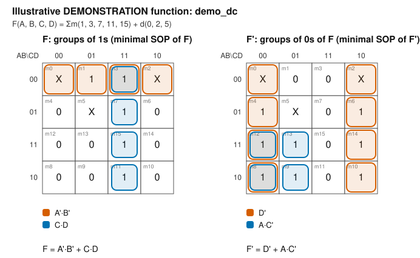

# Boolean analysis: `demo_dc`

<!-- GENERATED by tools/boolean_design/boolean_design.py - do not edit by hand -->

> **DEMONSTRATION FUNCTION.** This is an illustrative function chosen to exercise the toolchain. It is **not** any student's assigned registration-number function. The course sheets do not define a rule that maps a registration number to minterms, so none is assumed here.

* Config: `config/boolean_function.dontcare.example.json`
* Description: Illustrative 4-variable function with don't-cares: F = sum m(1,3,7,11,15) + d(0,2,5). A DEMONSTRATION only - not an assigned registration-number function.
* Variables (MSB first): A, B, C, D - minterm index = binary number `ABCD`
* Outputs: `F` = F, `F_n` = F'
* Minterms (F=1): [1, 3, 7, 11, 15]
* Maxterms (F=0): [4, 6, 8, 9, 10, 12, 13, 14]
* Don't-cares: [0, 2, 5]
* Mapping rule from registration number: **not defined** (minterms were supplied directly)

## 1. Truth table

| m | A | B | C | D | F (F) | F_n (F') |
|---|---|---|---|---|---|---|
| 0 | 0 | 0 | 0 | 0 | X | X |
| 1 | 0 | 0 | 0 | 1 | 1 | 0 |
| 2 | 0 | 0 | 1 | 0 | X | X |
| 3 | 0 | 0 | 1 | 1 | 1 | 0 |
| 4 | 0 | 1 | 0 | 0 | 0 | 1 |
| 5 | 0 | 1 | 0 | 1 | X | X |
| 6 | 0 | 1 | 1 | 0 | 0 | 1 |
| 7 | 0 | 1 | 1 | 1 | 1 | 0 |
| 8 | 1 | 0 | 0 | 0 | 0 | 1 |
| 9 | 1 | 0 | 0 | 1 | 0 | 1 |
| 10 | 1 | 0 | 1 | 0 | 0 | 1 |
| 11 | 1 | 0 | 1 | 1 | 1 | 0 |
| 12 | 1 | 1 | 0 | 0 | 0 | 1 |
| 13 | 1 | 1 | 0 | 1 | 0 | 1 |
| 14 | 1 | 1 | 1 | 0 | 0 | 1 |
| 15 | 1 | 1 | 1 | 1 | 1 | 0 |

## 2. Canonical forms (don't-cares are not listed)

* F  = Σm(1, 3, 7, 11, 15) = A'·B'·C'·D + A'·B'·C·D + A'·B·C·D + A·B'·C·D + A·B·C·D
* F  = ΠM(4, 6, 8, 9, 10, 12, 13, 14) = (A + B' + C + D)·(A + B' + C' + D)·(A' + B + C + D)·(A' + B + C + D')·(A' + B + C' + D)·(A' + B' + C + D)·(A' + B' + C + D')·(A' + B' + C' + D)
* F' = Σm(4, 6, 8, 9, 10, 12, 13, 14) = A'·B·C'·D' + A'·B·C·D' + A·B'·C'·D' + A·B'·C'·D + A·B'·C·D' + A·B·C'·D' + A·B·C'·D + A·B·C·D'
* F' = ΠM(1, 3, 7, 11, 15) = (A + B + C + D')·(A + B + C' + D')·(A + B' + C' + D')·(A' + B + C' + D')·(A' + B' + C' + D')

## 3. Minimal forms (Quine-McCluskey, exact cover)

Selection criterion: fewest product/sum terms, then fewest literals. Minimal under *that criterion* for two-level forms; this is not a claim about multi-level or gate-count-optimal circuits.

* F  (SOP) = A'·B' + C·D
* F  (POS) = (D)·(A' + C)
* F' (SOP) = D' + A·C'
* F' (POS) = (A + B)·(C' + D')

POS forms come from De Morgan's law applied to the minimal SOP of the complement: F = (F')' = Π(complemented-literal sums).

## 4. Karnaugh maps

K-map of F (X = don't-care):

| AB\CD | 00 | 01 | 11 | 10 |
|---|---|---|---|---|
| **00** | X | 1 | 1 | X |
| **01** | 0 | X | 1 | 0 |
| **11** | 0 | 0 | 1 | 0 |
| **10** | 0 | 0 | 1 | 0 |

*Figure: K-maps of F and F' for `demo_dc` (generated; relative path `assets/diagrams/kmap_demo_dc.svg`).*

## 5. Boolean-law justification of each prime implicant

Each prime implicant is built by repeatedly applying the combining theorem `X·Y + X·Y' = X` to pairs of terms that differ in one variable. The steps below are the actual merges performed by the tool (not a free-form proof); equivalence of the final expressions with the truth table is verified exhaustively (section 7).

**F**

* Selected term `A'·B'` covers minterms [0, 1, 2, 3]
    * `A'·B'·C'` + `A'·B'·C` = `A'·B'` (variable C eliminated: X·C + X·C' = X)
    * `A'·B'·C'·D'` + `A'·B'·C'·D` = `A'·B'·C'` (variable D eliminated: X·D + X·D' = X)
    * `A'·B'·C·D'` + `A'·B'·C·D` = `A'·B'·C` (variable D eliminated: X·D + X·D' = X)
* Selected term `C·D` covers minterms [3, 7, 11, 15]
    * `A'·C·D` + `A·C·D` = `C·D` (variable A eliminated: X·A + X·A' = X)
    * `A'·B'·C·D` + `A'·B·C·D` = `A'·C·D` (variable B eliminated: X·B + X·B' = X)
    * `A·B'·C·D` + `A·B·C·D` = `A·C·D` (variable B eliminated: X·B + X·B' = X)

**F'**

* Selected term `D'` covers minterms [0, 2, 4, 6, 8, 10, 12, 14]
    * `A'·D'` + `A·D'` = `D'` (variable A eliminated: X·A + X·A' = X)
    * `A'·B'·D'` + `A'·B·D'` = `A'·D'` (variable B eliminated: X·B + X·B' = X)
    * `A'·B'·C'·D'` + `A'·B'·C·D'` = `A'·B'·D'` (variable C eliminated: X·C + X·C' = X)
    * `A'·B·C'·D'` + `A'·B·C·D'` = `A'·B·D'` (variable C eliminated: X·C + X·C' = X)
    * `A·B'·D'` + `A·B·D'` = `A·D'` (variable B eliminated: X·B + X·B' = X)
    * `A·B'·C'·D'` + `A·B'·C·D'` = `A·B'·D'` (variable C eliminated: X·C + X·C' = X)
    * `A·B·C'·D'` + `A·B·C·D'` = `A·B·D'` (variable C eliminated: X·C + X·C' = X)
* Selected term `A·C'` covers minterms [8, 9, 12, 13]
    * `A·B'·C'` + `A·B·C'` = `A·C'` (variable B eliminated: X·B + X·B' = X)
    * `A·B'·C'·D'` + `A·B'·C'·D` = `A·B'·C'` (variable D eliminated: X·D + X·D' = X)
    * `A·B·C'·D'` + `A·B·C'·D` = `A·B·C'` (variable D eliminated: X·D + X·D' = X)

## 6. Gate-level networks (two-input gates only)

Conventions: inputs are available in **true form only**; every complemented literal needs an inverter (counted once and shared inside a network). Wide terms are decomposed into balanced trees of two-input gates. In NAND-only/NOR-only networks an inverter is a two-input gate with tied inputs and counts as one gate. `F` and `F'` are built together, sharing input inverters. AOI/OAI networks end in the INV that produces the complement.

| Network | Realizes | Gate counts | Total gates | Depth |
|---|---|---|---|---|
| AND-OR-INV (`demo_dc_aoi`) | F' from SOP(F); F from SOP(F') | AND: 3, NOT: 6, OR: 2 | 11 | 4 |
| OR-AND-INV (`demo_dc_oai`) | F' from POS(F); F from POS(F') | AND: 2, NOT: 5, OR: 3 | 10 | 4 |
| NAND-NAND (`demo_dc_nand`) | F from SOP(F); F' from SOP(F') | NAND: 9 | 9 | 3 |
| NOR-NOR (`demo_dc_nor`) | F from POS(F); F' from POS(F') | NOR: 8 | 8 | 3 |

### Candidate comparison (each circuit realises ONE output on its own)

These are the circuits actually constructed and verified by the tool. The smallest one *among those evaluated* is marked; no global-optimality claim is made.

**Output F**

| Candidate | Gates (2-input) | of which inverters | Depth | Smallest of its type |
|---|---|---|---|---|
| NAND-NAND from minimal SOP | 5 | 2 | 3 | yes |
| NAND-NAND of the complement's minimal SOP + 1 inverter | 5 | 3 | 4 | yes |
| NAND-NAND from canonical SOP (unminimized) | 27 | 12 | 9 |  |
| NOR-NOR from minimal POS | 4 | 2 | 3 | yes |
| NOR-NOR of the complement's minimal POS + 1 inverter | 6 | 3 | 4 |  |
| NOR-NOR from canonical POS (unminimized) | 37 | 16 | 9 |  |

**Output F'**

| Candidate | Gates (2-input) | of which inverters | Depth | Smallest of its type |
|---|---|---|---|---|
| NAND-NAND from minimal SOP | 4 | 2 | 3 | yes |
| NAND-NAND of the complement's minimal SOP + 1 inverter | 6 | 3 | 4 |  |
| NAND-NAND from canonical SOP (unminimized) | 37 | 16 | 9 |  |
| NOR-NOR from minimal POS | 5 | 2 | 3 | yes |
| NOR-NOR of the complement's minimal POS + 1 inverter | 5 | 3 | 4 | yes |
| NOR-NOR from canonical POS (unminimized) | 28 | 13 | 9 |  |

Reading the table: the unminimized canonical-form rows show the benefit of minimization; the 'complement + 1 inverter' rows show whether building the opposite polarity and inverting is cheaper than the direct network.

## 7. Verification performed by the tool

* 104 expression evaluations (8 expressions x all care minterms) matched the truth table.
* The AOI, OAI, NAND-NAND and NOR-NOR netlists were simulated in Python for every care input; F and F' were complementary on every care input.
* The generated Verilog is verified separately by simulation: `python scripts/run_tests.py --test tb_demo_dc`.

## 8. Generated files

* `examples/registration-function/demo_dc/demo_dc_rtl.v`
* `examples/registration-function/demo_dc/tb_demo_dc.v`
* `docs/gate-count-analysis/demo_dc_gate_counts.md`
* `docs/truth-tables/demo_dc_truth_table.md`
* `assets/diagrams/kmap_demo_dc.svg`
* `docs/boolean-derivations/demo_dc.md`
