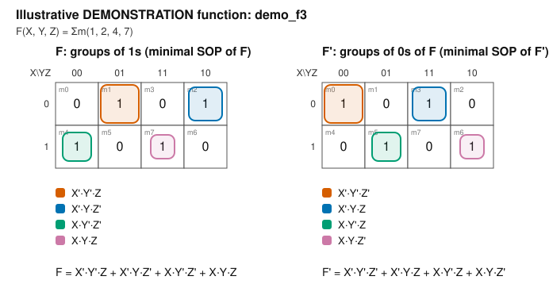

# Boolean analysis: `demo_f3`

<!-- GENERATED by tools/boolean_design/boolean_design.py - do not edit by hand -->

> **DEMONSTRATION FUNCTION.** This is an illustrative function chosen to exercise the toolchain. It is **not** any student's assigned registration-number function. The course sheets do not define a rule that maps a registration number to minterms, so none is assumed here.

* Config: `config/boolean_function.3var.example.json`
* Description: Illustrative 3-variable function F(X,Y,Z) = sum m(1,2,4,7) (3-input parity). A DEMONSTRATION only - not an assigned registration-number function.
* Variables (MSB first): X, Y, Z - minterm index = binary number `XYZ`
* Outputs: `F` = F, `F_n` = F'
* Minterms (F=1): [1, 2, 4, 7]
* Maxterms (F=0): [0, 3, 5, 6]
* Don't-cares: none
* Mapping rule from registration number: **not defined** (minterms were supplied directly)

## 1. Truth table

| m | X | Y | Z | F (F) | F_n (F') |
|---|---|---|---|---|---|
| 0 | 0 | 0 | 0 | 0 | 1 |
| 1 | 0 | 0 | 1 | 1 | 0 |
| 2 | 0 | 1 | 0 | 1 | 0 |
| 3 | 0 | 1 | 1 | 0 | 1 |
| 4 | 1 | 0 | 0 | 1 | 0 |
| 5 | 1 | 0 | 1 | 0 | 1 |
| 6 | 1 | 1 | 0 | 0 | 1 |
| 7 | 1 | 1 | 1 | 1 | 0 |

## 2. Canonical forms (don't-cares are not listed)

* F  = Σm(1, 2, 4, 7) = X'·Y'·Z + X'·Y·Z' + X·Y'·Z' + X·Y·Z
* F  = ΠM(0, 3, 5, 6) = (X + Y + Z)·(X + Y' + Z')·(X' + Y + Z')·(X' + Y' + Z)
* F' = Σm(0, 3, 5, 6) = X'·Y'·Z' + X'·Y·Z + X·Y'·Z + X·Y·Z'
* F' = ΠM(1, 2, 4, 7) = (X + Y + Z')·(X + Y' + Z)·(X' + Y + Z)·(X' + Y' + Z')

## 3. Minimal forms (Quine-McCluskey, exact cover)

Selection criterion: fewest product/sum terms, then fewest literals. Minimal under *that criterion* for two-level forms; this is not a claim about multi-level or gate-count-optimal circuits.

* F  (SOP) = X'·Y'·Z + X'·Y·Z' + X·Y'·Z' + X·Y·Z
* F  (POS) = (X + Y + Z)·(X + Y' + Z')·(X' + Y + Z')·(X' + Y' + Z)
* F' (SOP) = X'·Y'·Z' + X'·Y·Z + X·Y'·Z + X·Y·Z'
* F' (POS) = (X + Y + Z')·(X + Y' + Z)·(X' + Y + Z)·(X' + Y' + Z')

POS forms come from De Morgan's law applied to the minimal SOP of the complement: F = (F')' = Π(complemented-literal sums).

## 4. Karnaugh maps

K-map of F (X = don't-care):

| X\YZ | 00 | 01 | 11 | 10 |
|---|---|---|---|---|
| **0** | 0 | 1 | 0 | 1 |
| **1** | 1 | 0 | 1 | 0 |

*Figure: K-maps of F and F' for `demo_f3` (generated; relative path `assets/diagrams/kmap_demo_f3.svg`).*

## 5. Boolean-law justification of each prime implicant

Each prime implicant is built by repeatedly applying the combining theorem `X·Y + X·Y' = X` to pairs of terms that differ in one variable. The steps below are the actual merges performed by the tool (not a free-form proof); equivalence of the final expressions with the truth table is verified exhaustively (section 7).

**F**

* Selected term `X'·Y'·Z` covers minterms [1]
* Selected term `X'·Y·Z'` covers minterms [2]
* Selected term `X·Y'·Z'` covers minterms [4]
* Selected term `X·Y·Z` covers minterms [7]

**F'**

* Selected term `X'·Y'·Z'` covers minterms [0]
* Selected term `X'·Y·Z` covers minterms [3]
* Selected term `X·Y'·Z` covers minterms [5]
* Selected term `X·Y·Z'` covers minterms [6]

## 6. Gate-level networks (two-input gates only)

Conventions: inputs are available in **true form only**; every complemented literal needs an inverter (counted once and shared inside a network). Wide terms are decomposed into balanced trees of two-input gates. In NAND-only/NOR-only networks an inverter is a two-input gate with tied inputs and counts as one gate. `F` and `F'` are built together, sharing input inverters. AOI/OAI networks end in the INV that produces the complement.

| Network | Realizes | Gate counts | Total gates | Depth |
|---|---|---|---|---|
| AND-OR-INV (`demo_f3_aoi`) | F' from SOP(F); F from SOP(F') | AND: 12, NOT: 5, OR: 6 | 23 | 6 |
| OR-AND-INV (`demo_f3_oai`) | F' from POS(F); F from POS(F') | AND: 6, NOT: 5, OR: 12 | 23 | 6 |
| NAND-NAND (`demo_f3_nand`) | F from SOP(F); F' from SOP(F') | NAND: 29 | 29 | 7 |
| NOR-NOR (`demo_f3_nor`) | F from POS(F); F' from POS(F') | NOR: 29 | 29 | 7 |

### Candidate comparison (each circuit realises ONE output on its own)

These are the circuits actually constructed and verified by the tool. The smallest one *among those evaluated* is marked; no global-optimality claim is made.

**Output F**

| Candidate | Gates (2-input) | of which inverters | Depth | Smallest of its type |
|---|---|---|---|---|
| NAND-NAND from minimal SOP | 20 | 9 | 7 | yes |
| NAND-NAND of the complement's minimal SOP + 1 inverter | 21 | 10 | 8 |  |
| NAND-NAND from canonical SOP (unminimized) | 20 | 9 | 7 | yes |
| NOR-NOR from minimal POS | 20 | 9 | 7 | yes |
| NOR-NOR of the complement's minimal POS + 1 inverter | 21 | 10 | 8 |  |
| NOR-NOR from canonical POS (unminimized) | 20 | 9 | 7 | yes |

**Output F'**

| Candidate | Gates (2-input) | of which inverters | Depth | Smallest of its type |
|---|---|---|---|---|
| NAND-NAND from minimal SOP | 20 | 9 | 7 | yes |
| NAND-NAND of the complement's minimal SOP + 1 inverter | 21 | 10 | 8 |  |
| NAND-NAND from canonical SOP (unminimized) | 20 | 9 | 7 | yes |
| NOR-NOR from minimal POS | 20 | 9 | 7 | yes |
| NOR-NOR of the complement's minimal POS + 1 inverter | 21 | 10 | 8 |  |
| NOR-NOR from canonical POS (unminimized) | 20 | 9 | 7 | yes |

Reading the table: the unminimized canonical-form rows show the benefit of minimization; the 'complement + 1 inverter' rows show whether building the opposite polarity and inverting is cheaper than the direct network.

## 7. Verification performed by the tool

* 64 expression evaluations (8 expressions x all care minterms) matched the truth table.
* The AOI, OAI, NAND-NAND and NOR-NOR netlists were simulated in Python for every care input; F and F' were complementary on every care input.
* The generated Verilog is verified separately by simulation: `python scripts/run_tests.py --test tb_demo_f3`.

## 8. Generated files

* `examples/registration-function/demo_f3/demo_f3_rtl.v`
* `examples/registration-function/demo_f3/tb_demo_f3.v`
* `docs/gate-count-analysis/demo_f3_gate_counts.md`
* `docs/truth-tables/demo_f3_truth_table.md`
* `assets/diagrams/kmap_demo_f3.svg`
* `docs/boolean-derivations/demo_f3.md`
