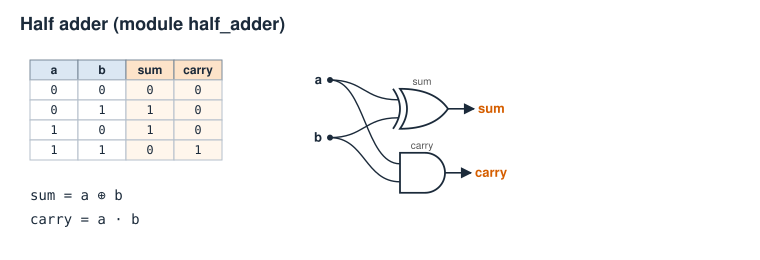
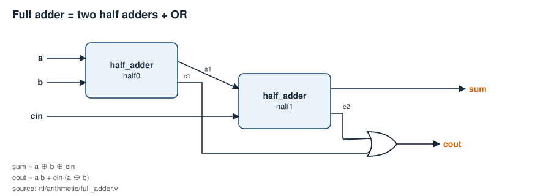
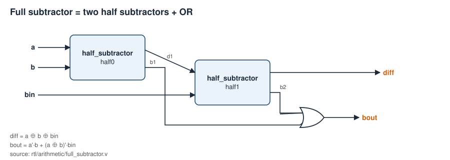
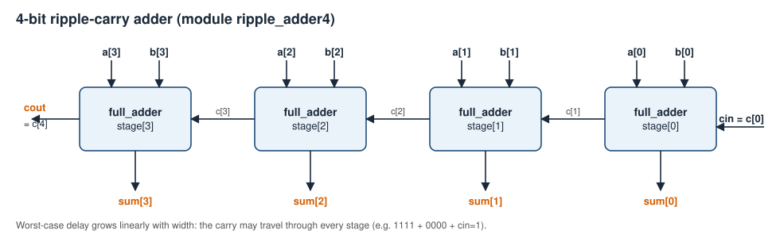
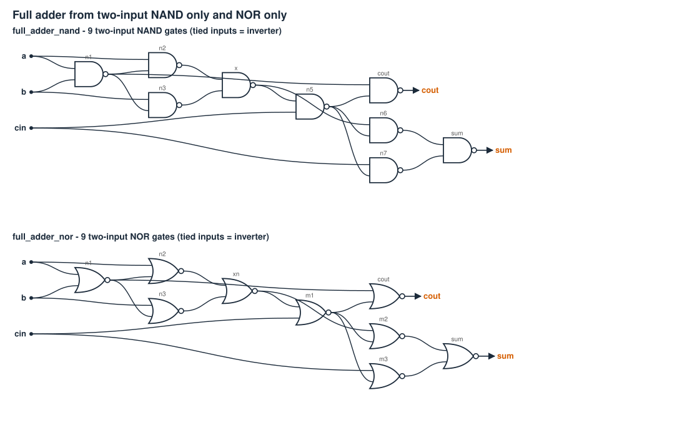
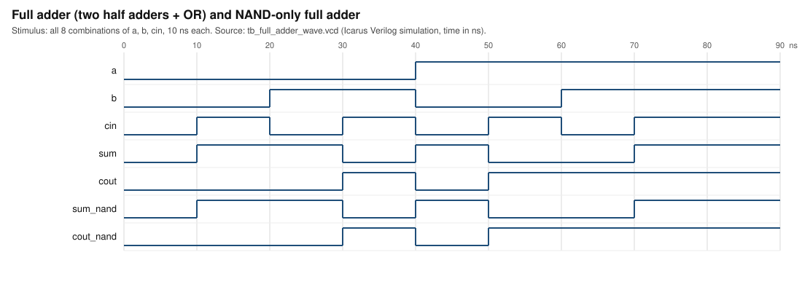
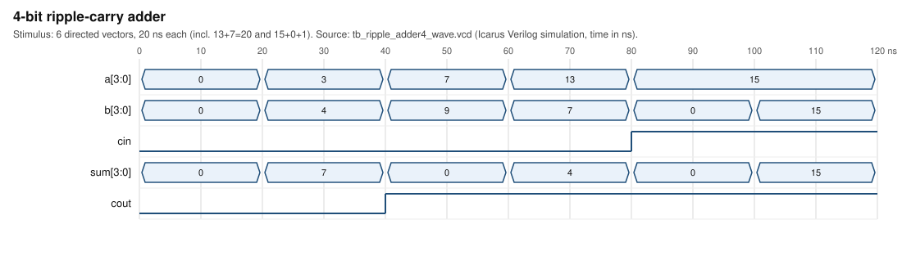

# Task I - Combinational circuits and datapath elements

## Aim
Design and model, in Verilog (behavioral `_bh`, structural plain/`_nand`/`_nor`/gates, dataflow `_df`), the adders, subtractors and small multipliers of lab task I, check them exhaustively, and compare NAND-only / NOR-only implementations by gate count.

## Requirements covered
| Sheet item | Where implemented |
|---|---|
| 4-bit adder from full adders; full adder from half adders + gates | `ripple_adder4`, `full_adder`, `half_adder` |
| 2x2, 3x3, 4x4 multipliers | `mult2x2`, `mult3x3`, `mult4x4` (+ `_df`, `_bh`) |
| Full adder / subtractor using MUX or decoder | `full_adder_mux`, `full_subtractor_mux`, `full_adder_decoder`, `full_subtractor_decoder` |
| 4-bit adder using basic gates | `ripple_adder4_gates` (20 xor/and/or), `ripple_adder4_nand` (36), `ripple_adder4_nor` (36) |
| Two-input NAND / NOR counts for HA, HS, FA, FS | `*_nand`, `*_nor` in `rtl/arithmetic/nand_nor_arith.v`; [gate-count report](gate-count-analysis/task01_nand_nor_gate_counts.md) |
| n-bit parallel adder | `ripple_adder_n #(WIDTH)` |
| 4-bit subtractor (sheet's circuit-diagram list) | `ripple_subtractor4`, `ripple_subtractor_n` (chained `full_subtractor`; `bout` = a < b + bin), `adder_subtractor` in `rtl/datapath` |

Tools: Icarus Verilog 12 + vvp (default), ModelSim/Questa (see [simulation guide](simulation/simulation-workflows.md)), Python 3.

## Theory (short)
* Half adder: `SUM = A ⊕ B`, `CARRY = A·B`. Half subtractor (A-B): `DIFF = A ⊕ B`, `BORROW = A'·B`.
* Full adder: `SUM = A ⊕ B ⊕ CIN`, `COUT = A·B + CIN·(A ⊕ B)` = two half adders + OR.
* Full subtractor (A-B-BIN): `DIFF = A ⊕ B ⊕ BIN`, `BOUT = A'·B + (A ⊕ B)'·BIN`. **BIN is the borrow *into* the stage; BOUT is the borrow out.**
* Ripple adder: `c[i+1]` of stage *i* is `cin` of stage *i+1*. 4-bit operands give a 5-bit result `{cout, sum}`; `cout=1` means unsigned overflow. For signed (two's complement) data overflow is `c[3] ⊕ c[4]` (see the ALU).
* An NxN **unsigned** product needs 2N bits (max `(2^N-1)^2 < 2^(2N)`): 2x2 → 4 bits, 3x3 → 6 bits, 4x4 → 8 bits. These are not the signed Booth multiplier of Task IV.

## Design procedure and derivation
Truth tables: [`docs/truth-tables/task01_arithmetic.md`](truth-tables/task01_arithmetic.md) (generated). K-map reading for the 3-variable functions: `SUM` is the odd-parity function (no adjacent 1s → no simplification, stays XOR), `COUT` groups into `AB + ACIN + BCIN` (majority) which equals `AB + CIN(A ⊕ B)`.



*Figure 1 - half adder truth table and gates (`assets/diagrams/half_adder.svg`, drawn from the RTL).*



*Figure 2 - full adder = 2 half adders + OR (`assets/diagrams/full_adder_from_half_adders.svg`).*



*Figure 3 - full subtractor (`assets/diagrams/full_subtractor.svg`).*



*Figure 4 - four-bit ripple-carry adder (`assets/diagrams/ripple_adder4.svg`).*

### Multiplier structure
`mult2x2`: four AND partial products `a_i b_j`, two half adders: `p0 = a0b0`; `(p1, c) = a1b0 + a0b1`; `(p2, p3) = a1b1 + c`. `mult3x3`/`mult4x4` use `mult_array_n`: row *i* adds `a & {N{b[i]}}` to the running sum with an N-bit ripple adder (cout + sum form an N+1-bit row result, the LSB is final product bit *i*).

### MUX- and decoder-based arithmetic
* MUX: 4:1 MUX with `{S1,S0} = {A,B}`; data inputs `SUM: CIN,~CIN,~CIN,CIN` (index 0..3), `COUT: 0,CIN,CIN,1`, `DIFF: BIN,~BIN,~BIN,BIN`, `BOUT: BIN,1,0,BIN`.
* Decoder: 3:8 decoder on `{A,B,X}` followed by OR gates: `SUM = m1+m2+m4+m7`, `COUT = m3+m5+m6+m7`, `DIFF = m1+m2+m4+m7`, `BOUT = m1+m2+m3+m7`.

### NAND-only / NOR-only
Inverters are NAND/NOR gates with tied inputs and count as one gate. Counts below come from parsing the RTL netlists ([full report](gate-count-analysis/task01_nand_nor_gate_counts.md)):

| Circuit | 2-input NAND | 2-input NOR |
|---|---|---|
| Half adder | 5 | 6 |
| Half subtractor | 5 | 5 |
| Full adder | 9 | 9 |
| Full subtractor | 9 | 11 |

The sheet asks to "justify that the circuit requires fewer logical elements". The honest statement supported by this repository: the shared XOR front end (`n1,n2,n3`) lets NAND realizations reuse `n1` for the carry; the NOR half subtractor gets its borrow for free (`n2 = a'·b`). These are the specific circuits built here - they are **not proven globally minimal**. Logic depth: NAND FA/FS 6 levels; NOR FA 6, NOR FS 8.



*Figure 5 - NAND-only vs NOR-only full adder (`assets/diagrams/nand_nor_adders.svg`; also `nand_nor_half_cells.svg`, `nand_nor_subtractors.svg`).*

### n-bit parallel adder
To add two n-bit numbers: line up bits, add column by column from the LSB, pass each carry to the next column - this is exactly `ripple_adder_n`. Synthetic example (not anyone's marks): 13 + 7 with n = 4 → `1101 + 0111 = 1_0100` → `sum = 4`, `cout = 1` (value 20). To add several values (e.g. a list of marks), chain adders with a wider result so the carries are never lost: n bits per operand needs n + ⌈log2 k⌉ bits for k operands.

## Testbenches and commands
```
python scripts/run_tests.py --task 1
python scripts/run_tests.py --test tb_half_full_adders
```
| Testbench | Coverage |
|---|---|
| `tb/task01/tb_half_full_adders.v` | every input of HA/HS (bh, df, st, nand, nor) and FA/FS (+ mux, decoder) vs integer arithmetic |
| `tb/task01/tb_ripple_adder.v` | all 512 `(a,b,cin)` for six 4-bit adders; all 131072 for `ripple_adder_n` WIDTH=8 |
| `tb/task01/tb_ripple_subtractor.v` | all 512 `(a,b,bin)` for the 4-bit subtractor, all 131 072 for WIDTH=8 |
| `tb/task01/tb_multipliers.v` | all operand pairs of 2x2, 3x3, 4x4 in 3 styles vs repeated addition; max/zero corners |
| `tb/task01/tb_full_adder_wave.v`, `tb_ripple_adder4_wave.v` | small waveform scenarios |

## Actual verification results
See [test_results.md](simulation/test_results.md) (generated by a real run): all Task I testbenches PASS.

## Waveform evidence


*Figure 6 - rendered from `assets/waveforms/tb_full_adder_wave.vcd` (Icarus Verilog simulation).*



*Figure 7 - rendered from `assets/waveforms/tb_ripple_adder4_wave.vcd`; 13+7=20 gives sum=4, cout=1.*

## Inference
All adder/subtractor styles are functionally identical for every input; structural variants differ only in gate count and depth. Ripple delay grows linearly with width (motivation for the CLA of Task IV). NAND-only is never larger than NOR-only in the circuits built here.

## Result
Every required circuit exists as synthesizable Verilog-2001 and passes exhaustive self-checking simulation. Physical/FPGA results: none for this task.

## Real-world applications
ALUs and address generators (adders), counters/subtractors in timers, multipliers in DSP and graphics, NAND-only logic in standard-cell/FPGA LUT mapping.
