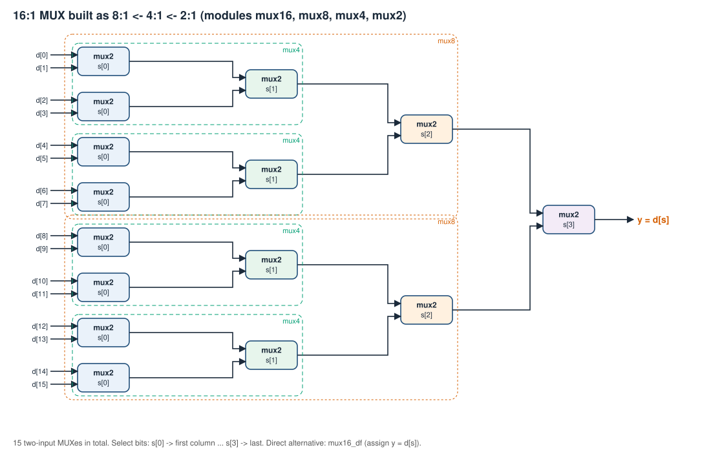
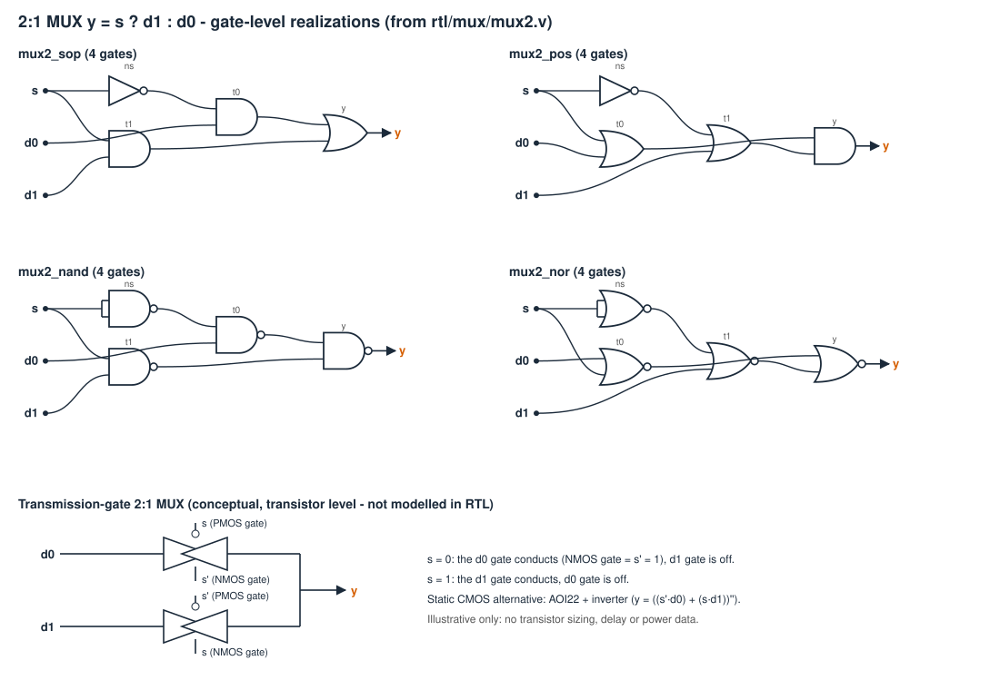
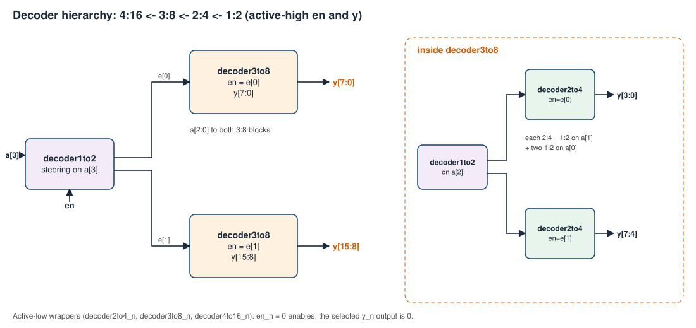
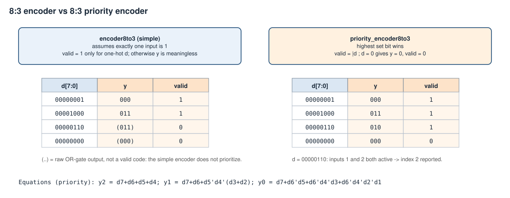
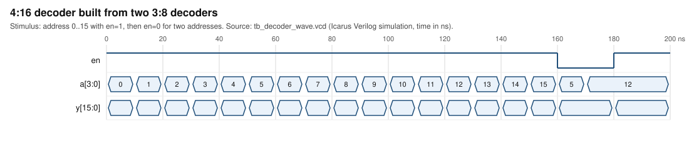
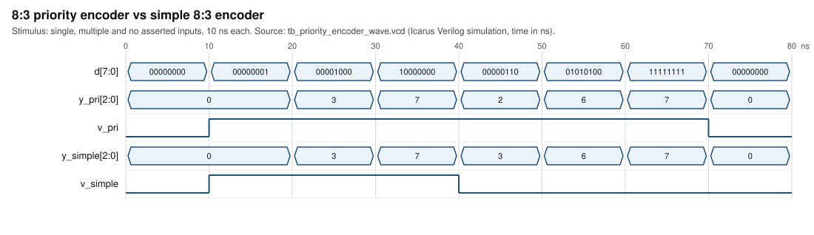

# Task III - Multiplexers, decoders, demultiplexers and encoders

## Aim
Build and verify 2:1 → 16:1 multiplexers hierarchically, the 1:2 → 4:16 decoder hierarchy, demultiplexers, simple and priority encoders, and use a MUX and a decoder to realize a configured Boolean function (the Task II truth table).

## Conventions (read first)
* **Select/address bit order:** `s` / `a` is an unsigned binary number, bit 0 = LSB. `Y = D[s]` for every MUX size.
* **MUX selection table:** 2:1: s=0→D0, s=1→D1. 4:1: s=00→D0, 01→D1, 10→D2, 11→D3. 8:1 / 16:1 continue the same pattern (see [truth tables](truth-tables/task03_mux_decoder_encoder.md)). Hierarchy: the LSB `s[0]` drives the leaf 2:1 stage, so selected index = s.
* **Decoders:** main modules have active-high enable `en` and active-high outputs `y`. Active-low wrappers carry `_n` in the name (`decoder2to4_n`: input `en_n`, outputs `y_n`; `en_n = 0` enables; selected output = 0). The internal 2:4 realizations are named by polarity: `_sop`/`_nor` = active-high `y`, `_pos`/`_nand` = active-low `y_n`.
* **Encoders:** simple encoders assume exactly one input high; priority encoders pick the highest index.

## Requirements covered
| Sheet item | Module(s) |
|---|---|
| 16:1 from 8:1 from 4:1 from 2:1 | `mux16` ← `mux8` ← `mux4` ← `mux2` (plus direct `mux16_df`, `mux16_bh`, and `_df/_bh` for 4:1, 8:1) |
| 2:1 internal: SOP, POS, NAND, NOR | `mux2_sop`, `mux2_pos`, `mux2_nand`, `mux2_nor`; CMOS / transmission-gate drawing is **conceptual only** |
| Function using 16:1 and 8:1 MUX | generated `<name>_mux16`, `<name>_mux8` |
| 4:16 from 3:8 from 2:4 | `decoder4to16`, `decoder3to8`, `decoder2to4` (+ `decoder1to2` steering) |
| 2:4 internal: SOP, POS, NAND, NOR | `decoder2to4_sop/_pos/_nand/_nor` |
| Function using a decoder | generated `<name>_dec` |
| Encoder, priority encoder, demux | `encoder4to2/8to3`, `priority_encoder4to2/8to3`, `demux1to2`, `demux1to4` |

## Design notes and equations
* 2:1 MUX: `Y = S'·D0 + S·D1 = (D0 + S)·(S' + D1)`. NAND form `Y = ((S'D0)'·(S D1)')'` = 4 NAND (inverter = tied NAND). NOR form `Y = ((D0+S)' + (S'+D1)')'` = 4 NOR. SOP/POS use 4 gates (1 NOT + 2 + 1).
* Larger MUX: 15 two-input MUXes for 16:1 (8+4+2+1). The direct dataflow 16:1 (`assign y = d[s]`) is functionally identical; hierarchy exposes the structure, synthesis tools may restructure either.
* Decoder hierarchy: the MSB goes to a 1:2 decoder whose outputs are the enables of two lower-order decoders. 4:16 = 1:2 + 2×3:8; 3:8 = 1:2 + 2×2:4; 2:4 = 1:2 + 2×1:2.
* Demux: a decoder whose enable is the data (`demux1to4` instantiates `decoder2to4` with `en = din`); inactive outputs are 0.
* Encoder equations: `y1 = d2+d3`, `y0 = d1+d3`; 8:3: `y2 = d4+d5+d6+d7`, `y1 = d2+d3+d6+d7`, `y0 = d1+d3+d5+d7`. `valid` = exactly-one-hot. For all-zero or multi-hot input `valid = 0` and `y` is the raw OR result - **not** prioritized and must be ignored.
* Priority encoder: `y1 = d3 + d2`, `y0 = d3 + d2'·d1`, `valid = |d`; all-zero → `y = 0, valid = 0`.
* **Encoder vs decoder:** a decoder expands n bits to 2^n one-hot lines; an encoder does the reverse. **MUX vs DEMUX:** MUX selects one of many inputs; DEMUX routes one input to one of many outputs.
* Function realization: 16:1 MUX data inputs = the truth-table column (`d[i]` = F at minterm i, don't-cares tied 0); 8:1 MUX (variable-entered): select = all variables but the last, each data input is `0`, `1`, `V` or `V'` from the row pair. Decoder: `F = OR` of the minterm lines, `F' = OR` of the zero lines.



*Figure 1 - hierarchical 16:1 MUX (`assets/diagrams/mux_hierarchy.svg`).*



*Figure 2 - 2:1 MUX SOP/POS/NAND/NOR (drawn from the RTL) and a conceptual transmission-gate MUX (`assets/diagrams/mux2_internal.svg`). No transistor-level characterization is implied.*



*Figure 3 - decoder hierarchy (`assets/diagrams/decoder_hierarchy.svg`).*



*Figure 4 - simple vs priority encoder (`assets/diagrams/encoder_vs_priority.svg`).*

## Testbenches and commands
```
python scripts/run_tests.py --task 3
python scripts/run_tests.py --test tb_demo_f4      # MUX/decoder function realization
```
| Testbench | Coverage |
|---|---|
| `tb/task03/tb_mux.v` | all 5 mux2 styles, mux4/8/16 in 3 styles: every select value × walking-1/0 data patterns, 4096 LFSR data patterns; expected = `d[sel]` |
| `tb/task03/tb_decoder.v` | every address, en=0/1, all styles, active-low, internal 2:4 polarities, one-hot property |
| `tb/task03/tb_encoder_demux.v` | all 256 (8:3) / 16 (4:2) patterns, valid flag, raw-OR behavior of the simple encoder, priority, all demux inputs |
| `tb/task03/tb_decoder_wave.v`, `tb_priority_encoder_wave.v` | waveform scenarios |
| `examples/registration-function/*/tb_*.v` | MUX-16, MUX-8 and decoder realizations of the configured functions vs the truth table |

## Actual verification results
[test_results.md](simulation/test_results.md) - all PASS in the recorded run. (A real bug in `mux2_nor` - an extra inverter - was found and fixed by `tb_mux` during development.)

## Waveform evidence


*Figure 5 - rendered from `assets/waveforms/tb_decoder_wave.vcd`: one-hot output follows the address; en=0 forces all zeros.*



*Figure 6 - rendered from `assets/waveforms/tb_priority_encoder_wave.vcd`; for d=00000110 the priority encoder reports 2, the simple encoder drops `v_simple`.*

## Inference / Result
Hierarchical and direct implementations agree for every select value; decoders assert exactly one line when enabled; the simple encoder is only valid for one-hot inputs while the priority encoder is total. All required Task III modules are implemented and verified in simulation.

## Real-world applications
Data routing and bus selection (MUX/DEMUX), memory address decoding (decoders), interrupt controllers (priority encoders), keyboard scanning (encoders), LUT-based logic in FPGAs (a k-input LUT is a 2^k:1 MUX over configuration bits).
