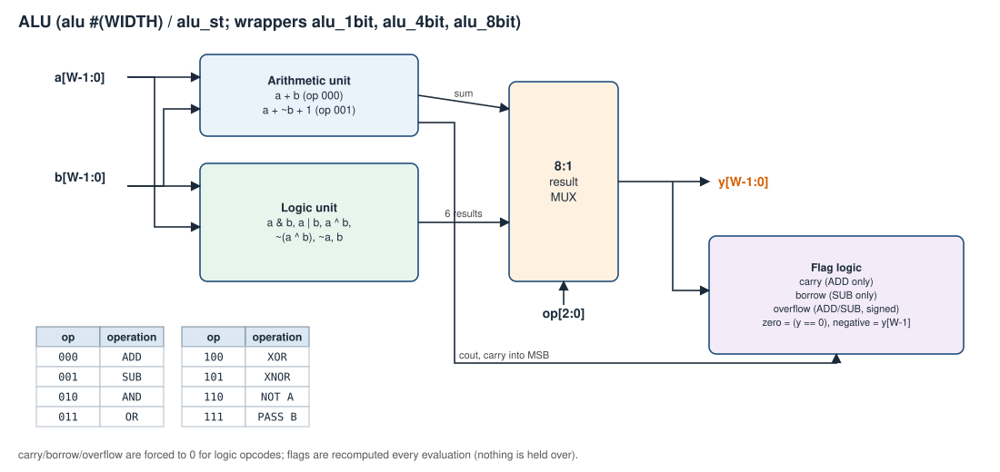
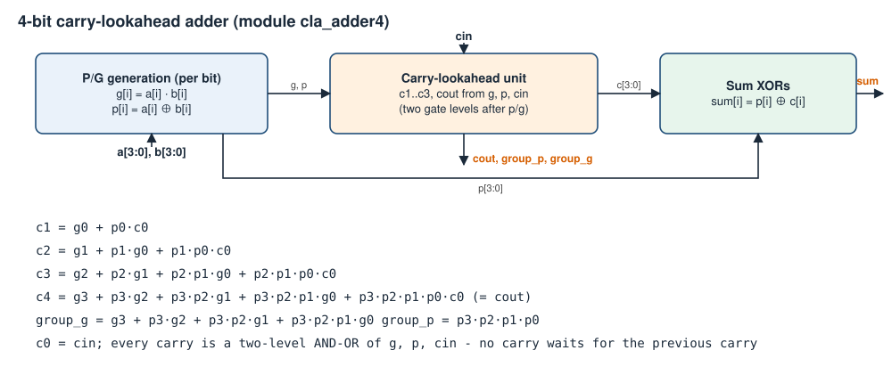
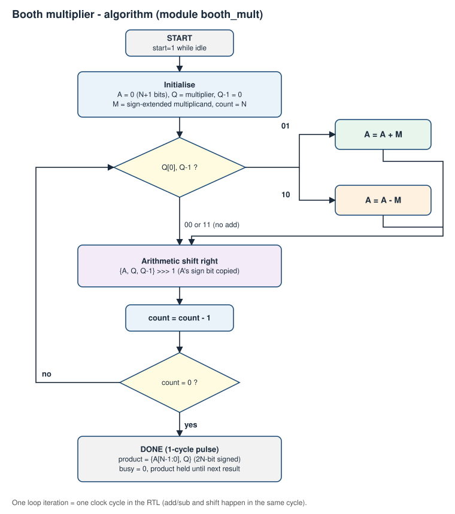
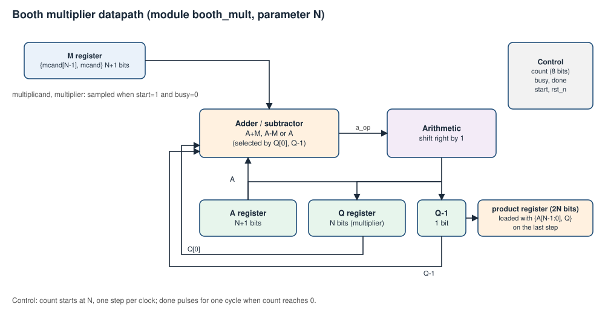
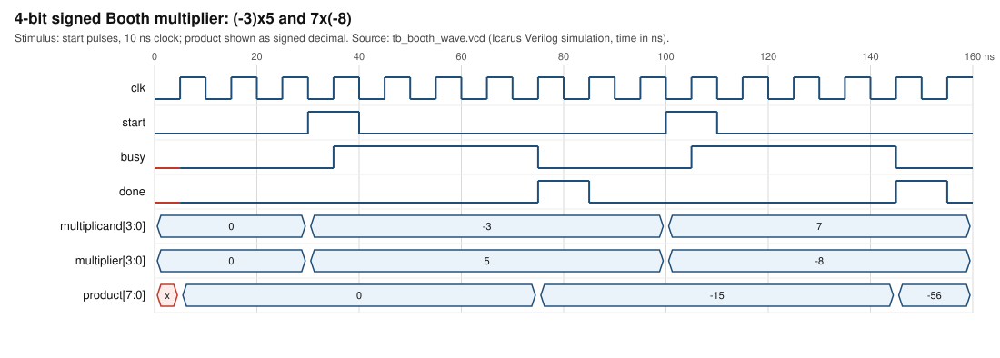
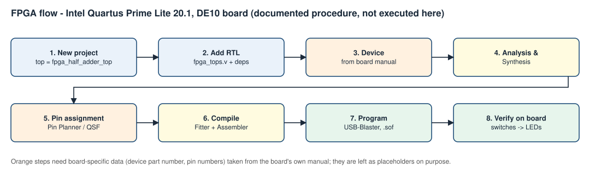

# Task IV - ALU, datapath elements, Booth multiplier, CLA and FPGA

## Aim
Design 1-, 4- and 8-bit ALUs with eight functions, supporting datapath blocks (incrementer, decrementer, adder/subtractor, comparators), a carry-lookahead adder, a signed Booth multiplier, a 4-bit comparator from 1-bit cells, and document the Quartus/DE10 half-adder flow.

## Requirements covered
| Sheet item | Module(s) |
|---|---|
| ALU 1/4/8-bit, 8 functions | `alu #(WIDTH)`, `alu_1bit/4bit/8bit`, structural `alu_st` |
| Datapath elements | `incrementer`, `decrementer`, `adder_subtractor`, `comparator1(_df/_bh)`, `comparator4`, `mult*`, `cla_adder4/16`, `booth_mult` (divider: optional, not implemented) |
| Booth multiplier + flowchart + circuit | `booth_mult`, figures below |
| CLA + working principle | `cla_adder4`, `cla_adder16` |
| 4-bit comparator (SL) from 1-bit (BL, SL, DFL) | `comparator4` ← `comparator1` (+ `_df`, `_bh` 1-bit variants) |
| Half adder on DE10 / Quartus Lite 20.1; assigned circuit | `fpga_half_adder_top`, `fpga_alu4_top`; **documented, not executed** - see [FPGA guide](fpga/quartus-de10-workflow.md) |
| Theory/viva: FPGA vs ASIC, calculator vs computer, RISC vs CISC, ALU parts, Booth, CLA | [docs/theory/](theory/README.md) |

## ALU specification
Opcode map (identical at every width; all 8 encodings used, none reserved), defined in `rtl/alu/alu_opcodes.vh`:

| op | name | result | op | name | result |
|---|---|---|---|---|---|
| 000 | ADD | a + b | 100 | XOR | a ^ b |
| 001 | SUB | a - b | 101 | XNOR | ~(a ^ b) |
| 010 | AND | a & b | 110 | NOT A | ~a |
| 011 | OR | a \| b | 111 | PASS B | b |

Flags are recomputed from the current inputs (no state, nothing stale):
* `carry` - ADD only: carry out of the MSB (unsigned overflow); 0 for every other op.
* `borrow` - SUB only: 1 when a < b (unsigned); 0 otherwise. Implemented as `a + ~b + 1` in `alu_st` (borrow = ~carry-out); `alu` uses a (W+1)-bit subtraction.
* `overflow` - ADD/SUB only: signed two's-complement overflow (`ADD`: operands same sign, result different; `SUB`: operands different sign, result sign ≠ a's sign); 0 otherwise. At W=1 values are 0 and -1.
* `zero` = (y == 0) and `negative` = y[W-1] for **every** opcode (sign bit of the result; only an arithmetic "negative" for signed data).

Full 1-bit function table: [truth-tables/task04_alu.md](truth-tables/task04_alu.md).



*Figure 1 - ALU block diagram (`assets/diagrams/alu_block.svg`).*

`alu` is behavioral/dataflow; `alu_st` is structural: one `alu_slice` per bit (reusing `full_adder`, `mux8` for the result select) with a ripple carry chain. Both are compared with an independent integer reference.

## Carry-lookahead adder
Per bit `g = a·b`, `p = a ⊕ b`; `c[i+1] = g[i] + p[i]·c[i]`, expanded so each carry depends only on g, p, cin (equations in the figure). `sum[i] = p[i] ⊕ c[i]`. Delay intuition: ripple needs about N carry stages in series; CLA computes all carries in two gate levels after p/g (at the cost of wider AND/OR gates - fan-in grows with width), so 4-bit blocks are chained with a second lookahead level using `group_p`/`group_g` (`cla_adder16`). The comparison is qualitative here - no timing numbers were measured.



*Figure 2 - carry-lookahead adder (`assets/diagrams/cla_adder4.svg`).*

## 4-bit comparator
`comparator1`: `gt = a·b'`, `lt = a'·b`, `eq = a ⊙ b`. `comparator4` instantiates four of them: `eq = e3e2e1e0`, `gt = g3 + e3g2 + e3e2g1 + e3e2e1g0`, `lt` analogous (MSB-first priority).

## Signed Booth multiplier
Radix-2 Booth recoding looks at `{Q[0], Q-1}` each step: `01` → A = A + M, `10` → A = A - M, `00/11` → nothing; then arithmetic shift right of `{A, Q, Q-1}`. N steps give a 2N-bit signed product `{A[N-1:0], Q}`. `A` is N+1 bits so the add/subtract cannot overflow.

**Interface/timing** (RTL `rtl/multipliers/booth_mult.v`): operands are sampled on the clock edge where `start=1` and `busy=0`; `start` while busy is ignored; `busy` is high for N cycles; `done` is a 1-cycle pulse when `busy` falls; `product` is valid when `done=1` and held until the next completion; `rst_n` is a synchronous active-low reset that also clears `product`. Accept-to-done latency = N clock edges after the accepting edge.



*Figure 3 - Booth algorithm flowchart (`assets/diagrams/booth_flowchart.svg`).*



*Figure 4 - Booth datapath (`assets/diagrams/booth_datapath.svg`).*

### Worked negative-number example: (-3) × 5, N = 4
M = 1101 (-3), Q = 0101 (5). Trace printed by the simulation ([booth_trace_N4.txt](simulation/booth_trace_N4.txt)); A is 5 bits:

| step | A | Q | Q-1 | {Q0,Q-1} | action | after shift: A, Q, Q-1 |
|---|---|---|---|---|---|---|
| 1 | 00000 | 0101 | 0 | 10 | A = A - M = 00011 | 00001, 1010, 1 |
| 2 | 00001 | 1010 | 1 | 01 | A = A + M = 11110 | 11111, 0101, 0 |
| 3 | 11111 | 0101 | 0 | 10 | A = A - M = 00010 | 00001, 0010, 1 |
| 4 | 00001 | 0010 | 1 | 01 | A = A + M = 11110 | 11111, 0001, 0 |

Product = `{A[3:0], Q}` = `1111_0001` = -15 ✓ (the trace lines in the log match these rows).



*Figure 5 - rendered from `assets/waveforms/tb_booth_wave.vcd`: (-3)×5 = -15 and 7×(-8) = -56.*

## Testbenches and commands
```
python scripts/run_tests.py --task 4
python scripts/make_waveforms.py       # regenerate VCD + SVG waveforms
```
| Testbench | Coverage |
|---|---|
| `tb_alu.v` | **exhaustive**: every (a, b, op) at W=1, 4, 8 (1 048 576 comparisons at W=8 incl. the structural ALU) of y, carry, borrow, overflow, zero, negative against an integer/signed reference |
| `tb_cla_adder.v` | cla_adder4 all 512 vectors (+ group P/G), cla_adder16 corners + 200 000 fixed-seed random vectors (not exhaustive: 2^33) |
| `tb_datapath.v` | comparators 1/4-bit, incrementer, decrementer, adder/subtractor (incl. overflow) exhaustive at 4 bits |
| `tb_booth_mult.v` | all signed pairs at N=4 (256) and N=8 (65 536); min/max/-1/0 corners; busy/done timing, 1-cycle done, product hold, start-while-busy ignored, reset mid-operation |
| `tb_fpga_tops.v` | simulation-only check of the FPGA top levels |
| `tb_alu_wave.v`, `tb_booth_wave.v` | waveform scenarios |

Mutation sanity check performed during development: deliberately breaking the SUB-overflow term, the structural borrow, the Booth subtract/shift, a decoder enable, an encoder equation, a NOR full-adder wire, and a CLA carry term each made the corresponding testbench FAIL (changes reverted).

## Actual verification results
[test_results.md](simulation/test_results.md): all PASS in the recorded run.


*Figure 6 - rendered from `assets/waveforms/tb_alu_wave.vcd`: eight opcodes on a=5A, b=3C, then flag corner cases (carry, signed overflow, borrow, zero).*

## FPGA status
Documented and templated, **not executed**: Quartus Prime and a DE10 board were not available. No pin assignments or device IDs are provided because the course sheet does not state the DE10 variant. See [FPGA guide](fpga/quartus-de10-workflow.md).



*Figure 7 - documented Quartus flow (`assets/diagrams/fpga_flow.svg`).*

## Inference / Result
The ALU behaves identically at 1, 4 and 8 bits with one opcode map and well-defined flags; CLA and ripple adders agree on every tested vector; the Booth multiplier is correct for all tested signed operand pairs. Hardware demonstration: pending (needs board).

## Real-world applications
ALUs in every CPU/MCU; comparators in sorting/branching; CLA in fast adders; Booth recoding in hardware multipliers/DSP; FPGA prototyping of datapaths.
